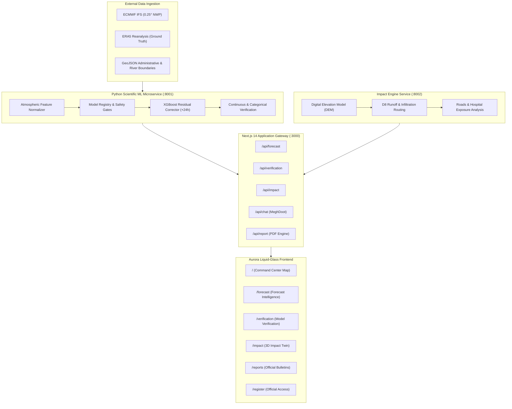

# HazardGuard

> **AI/ML Post-Processing of Numerical Weather Prediction (NWP) Rainfall Forecasts for Heavy & Very-Heavy Rainfall with Regime-Aware Uncertainty and 3D Rainfall-to-Impact Digital Twin**  
> *Developed for Smart India Hackathon (SIH) — Problem Statement ID: SIH26080*

---

## 📑 Table of Contents

- [📋 Overview](#-overview)
- [⚡ Quick Start](#-quick-start)
- [🎯 Problem Statement](#-problem-statement)
- [💡 Proposed Solution](#-proposed-solution)
- [📊 Key Features](#-key-features)
- [🏗️ System Architecture](#️-system-architecture)
- [🗄️ Dataset and Data Sources](#️-dataset-and-data-sources)
- [🛠️ Tools and Technology](#️-tools-and-technology)
- [⚙️ Methodology](#️-methodology)
- [🧪 Evaluation and Verification](#-evaluation-and-verification)
- [📁 Repository Structure](#-repository-structure)
- [🚀 Installation and Setup](#-installation-and-setup)
- [🔐 Configuration and Environment Variables](#-configuration-and-environment-variables)
- [▶️ Running the Application](#️-running-the-application)
- [🧰 API and Services](#-api-and-services)
- [🧭 Usage Guide](#-usage-guide)
- [✅ Testing and Quality Checks](#-testing-and-quality-checks)
- [📈 Results and Current Status](#-results-and-current-status)
- [⚠️ Limitations and Scientific Caveats](#️-limitations-and-scientific-caveats)
- [🔮 Future Work](#-future-work)
- [🤝 Contributing](#-contributing)
- [📄 License](#-license)

---

<a id="-overview"></a><a id="overview"></a>
## 📋 Overview

Numerical Weather Prediction (NWP) systems—such as ECMWF IFS, GFS, and regional mesoscale models—are fundamental to modern meteorology, but their raw precipitation outputs suffer from systematic physical limitations. Coarse horizontal grid spacing (9 to 25 km) fails to resolve convective cloud dynamics, localized orographic updrafts, and boundary-layer thermodynamics. Consequently, operational weather models frequently exhibit spatial displacement errors, systematic dry/wet biases, and poor predictive skill for localized **heavy (≥ 64.5 mm/day)** and **very-heavy (≥ 115.6 mm/day)** rainfall events across the diverse meteorological regimes of India.

**HazardGuard** is an end-to-end meteorological post-processing and impact intelligence platform built to solve this operational bottleneck. Designed for the Smart India Hackathon (SIH26080), HazardGuard couples physics-disciplined machine learning error correction with interactive geospatial decision support and an experimental 3D hydrodynamic digital twin.

Key design principles of HazardGuard:
1. **Regime-Aware Post-Processing**: Dissects atmospheric conditions across characteristic Indian synoptic regimes (Active Monsoon, Break Monsoon, Monsoon Depressions, Orographic Enhancement, Coastal Convection, and Western Disturbances) to isolate regime-specific bias patterns.
2. **Safety-Gated Machine Learning**: Employs an explicit validation gate. If an ML correction model fails to demonstrate statistically significant skill improvements (RMSE and Critical Success Index) over the raw dynamical model on held-out validation sets—as observed at extended lead times—the system **fails safe to raw NWP ensemble data** rather than serving degraded predictions.
3. **Scientifically Honest Probability Semantics**: Preserves clear distinctions between atmospheric precipitation exceedance frequency, ensemble quantile spreads ($P_{10}$, $P_{50}$, $P_{90}$), and ground-level flood risk. Uncalibrated raw ensemble frequencies are never presented as calibrated hazard probabilities.
4. **Rainfall-to-Impact Translation**: Bridges the gap between atmospheric accumulation in millimeters and surface disruption through a 3D Rainfall-to-Impact Digital Twin, modeling D8 terrain runoff routing, infiltration decay, road network congestion, and critical infrastructure exposure (hospitals, schools, power sub-stations).
5. **Operational Decision Support**: Delivers an Aurora liquid-glass command center featuring pan-India district monitoring (700+ districts), 72-hour forecast timelines, downloadable executive PDF bulletins, and the MeghDoot AI meteorological intelligence assistant.

---

<a id="-quick-start"></a><a id="quick-start"></a>
## ⚡ Quick Start

Follow these verified steps to launch HazardGuard locally in development mode.

### Prerequisites
- **Node.js**: v18.17.0+ or v20.x installed
- **Python**: v3.12 (64-bit recommended)
- **Git**: Installed and on system `PATH`

### 1. Clone & Enter Repository
```bash
git clone https://github.com/Ronak-4507/HazardGuard.git
cd HazardGuard/hazardguard
```

### 2. Install Frontend Dependencies
```bash
npm install
```

### 3. Launch Development Server
```bash
npm run dev
```
Open your browser at **[http://localhost:3000](http://localhost:3000)** to view the command center.

> **Note on Microservices**: Next.js API routes automatically serve bundled, high-fidelity India district data and baseline forecast fixtures when backend Python microservices are offline. To run live ML inference or the 3D physics runner, launch the optional microservices below:

```bash
# Terminal 2 (Optional: Scientific ML Microservice on port 8001)
npm run dev:ml

# Terminal 3 (Optional: 3D Impact Simulation Microservice on port 8002)
npm run dev:impact
```

---

<a id="-problem-statement"></a><a id="problem-statement"></a>
## 🎯 Problem Statement

### SIH Problem Statement ID: SIH26080
**Theme:** Disaster Management / Numerical Weather Prediction (NWP) Post-Processing  
**Title:** AI/ML Post-Processing of Numerical Weather Prediction (NWP) Rainfall Forecasts with Emphasis on Heavy and Very-Heavy Rainfall Prediction

### Operational Challenge
In monsoon-dominated South Asia, extreme precipitation events trigger flash flooding, urban inundation, agricultural destruction, and catastrophic infrastructure failures. While global NWP centers produce daily multi-member ensembles, local emergency planners encounter severe operational hurdles:
- **Spatial Resolution Mismatch**: Atmospheric dynamical cores operate at 9–25 km grid resolutions, smoothing out extreme localized convective cells.
- **Extreme Event Bias**: Standard mean-squared-error loss functions incentivize models to predict safe climatological averages, dampening rainfall extremes and causing high False Alarm Rates (FAR) or low Probability of Detection (POD) for rainfall over 64.5 mm.
- **Lead-Time Uncertainty**: As forecast lead times extend from +24h to +72h, dynamical spread widens significantly, yet decision-makers are rarely given regime-specific confidence bounds.
- **Communication Gap**: Municipal commissioners and disaster managers cannot interpret raw atmospheric millimeter metrics without understanding surface runoff accumulation, road impassability, and facility exposure.

HazardGuard directly addresses this challenge by applying machine learning residual post-processing to dynamical NWP outputs and connecting the corrected hazard to district-level action thresholds and surface impact simulations.

---

<a id="-proposed-solution"></a><a id="proposed-solution"></a>
## 💡 Proposed Solution

HazardGuard implements a modular, multi-tier pipeline connecting global numerical weather models to hyper-local district decision makers:

```
[ Raw NWP Ensemble Inputs ]
  ├── ECMWF IFS (0.25° grid)
  └── Multi-Model Ensembles
              │
              ▼
[ Atmospheric Feature Extraction ]
  ├── Thermodynamic & Kinematic Variables (Temp, RH, Surface Pressure, Cloud Cover)
  ├── Dynamic Wind Vectors (u, v components)
  └── Cyclical Temporal & Spatial Encodings (sin/cos DOY, Latitude, Longitude)
              │
              ▼
[ Safety-Gated Model Router ]
  ├── +24h Lead: Operational XGBoost Residual Corrector (`hazardguard_v7_24h`)
  └── +48h / +72h Leads: Automatic Fallback to RAW Dynamical NWP (Safety Gate Active)
              │
              ▼
[ Uncertainty & Hazard Quantification ]
  ├── Ensemble Quantiles: P10 (optimistic), P50 (median), P90 (conservative)
  └── IMD Categorical Exceedance: Moderate, Heavy (≥64.5mm), Very-Heavy (≥115.6mm)
              │
              ▼
[ Application & Visualization Tier ]
  ├── Geospatial Command Center: Pan-India MapLibre Vector Map (700+ Districts)
  ├── 3D Rainfall-to-Impact Digital Twin: Three.js Terrain Runoff, Inundation & Road Exposure
  ├── Executive State Reports: Automated PDF Generation (@react-pdf/renderer)
  └── Meteorological Copilot: MeghDoot Context-Aware LLM Assistant
```

---

<a id="-key-features"></a><a id="key-features"></a>
## 📊 Key Features

### 1. Meteorological Post-Processing Engine
- **Residual Bias Correction**: Operational gradient-boosted decision tree model (`hazardguard_v7_24h`) trained to predict additive residuals between ECMWF IFS raw precipitation forecasts and ground-truth observations.
- **Safety-Gated Lead Routing**: Automatic fail-safe mechanism that falls back to raw dynamical NWP whenever ML candidates fail to beat baseline skill criteria on validation benchmarks.
- **Threshold Exceedance Evaluation**: Real-time evaluation of heavy (≥64.5 mm/24h) and very-heavy (≥115.6 mm/24h) precipitation event probabilities.
- **Ensemble Quantiles**: Displays $P_{10}$ (10th percentile), $P_{50}$ (median), and $P_{90}$ (90th percentile) forecast spreads.

### 2. Pan-India Geospatial Command Center
- **Interactive MapLibre GL Visualization**: High-performance vector rendering of all Indian state and district administrative boundaries.
- **Live Meteorological Overlays**: Switchable layers for raw vs. corrected precipitation, synoptic weather regimes, wind vectors, and heavy rainfall hazard markers.
- **72-Hour Lead-Time Scrubbing**: Step through forecast timesteps (T+0h, T+12h, T+24h, T+48h, T+72h) with dynamic map recoloring and telemetry synchronization.
- **District Detail Drawer**: Deep dive into district-specific hyetographs, atmospheric variables, regime assignments, and risk ratings.

### 3. 3D Rainfall-to-Impact Digital Twin
- **Procedural & DEM Terrain Rendering**: WebGL 3D city and terrain rendering powered by Three.js with realistic lighting, water shaders, and structural meshes.
- **D8 Hydrologic Runoff Simulation**: Topographic flow accumulation based on steepest descent slopes and Horton infiltration decay.
- **Inundation Mesh & Vector Flows**: Visual surface water depth accumulation with 3D animated particle flow vectors.
- **Infrastructure Exposure Analytics**: Intersects simulated water depth against critical facilities (hospitals, schools, power stations) and road network congestion bottlenecks.
- **Scenario Testing**: Switch between `LOW`, `BASE`, `HIGH`, and interactive `CUSTOM` (0–250 mm) rainfall scenarios to observe simulated water depth progression.

### 4. Automated State & District PDF Bulletins
- **Print-Ready Official Reports**: Client-side compiled PDF reports using `@react-pdf/renderer`.
- **Executive Summaries**: High-risk district listings, meteorological regime overviews, and infrastructure threat matrices for disaster managers.
- **Print-Safe Command Palette**: High-contrast, publication-grade styling ensuring legibility across physical and digital channels.

### 5. MeghDoot AI Meteorological Copilot
- **Context-Aware Assistance**: Conversational AI assistant grounded in real-time forecast snapshots, district telemetry, and meteorological glossaries.
- **Multi-Provider LLM Integration**: Free-tier Groq API (`llama-3-70b`) or OpenRouter integration with intelligent prompt templating and fallback responses.

### 6. Official Multi-Agency Registration
- **Role-Based Provisioning**: Dedicated registration and access management workflow for IMD, NDMA, SDMA, and DDMA administrative personnel.

---

<a id="️-system-architecture"></a><a id="-system-architecture"></a><a id="system-architecture"></a>
## 🏗️ System Architecture

HazardGuard is organized as a high-performance monorepo uniting a Next.js 14 frontend gateway with decoupled Python analytical microservices.

### Architectural Diagram



### Component Breakdown
1. **Frontend Presentation Tier (`app/`, `src/components/`)**: Built on Next.js 14 App Router, React 18, and Tailwind CSS. Employs custom Aurora liquid-glass visual primitives with hardware-accelerated backdrop filters and responsive viewports.
2. **Geospatial & 3D Layer (`src/components/map/`, `src/components/impact/`)**: MapLibre GL renders vector tiles and GeoJSON district boundaries; Three.js manages procedural 3D elevation meshes, flood textures, building extrusions, and camera controls.
3. **Application API Gateway (`app/api/`)**: Internal Next.js TypeScript route handlers acting as adapters between the frontend and analytical microservices. Enforces fail-safe contracts, input validation, and offline fixture fallbacks.
4. **Scientific ML Microservice (`services/ml_api/main.py`, `ml/`)**: FastAPI application serving REST endpoints (`/ml/forecast`, `/ml/probability`, `/ml/verification`). Loads production model artifacts, normalizes atmospheric features, and executes inference.
5. **Impact Simulation Microservice (`services/impact_engine/`)**: Node.js Express server spawning standalone Python hydraulic routing scripts (`run_simulation_cli.py`) for DEM slope calculation, water accumulation, and infrastructure risk intersection.

---

<a id="️-dataset-and-data-sources"></a><a id="-dataset-and-data-sources"></a><a id="dataset-and-data-sources"></a>
## 🗄️ Dataset and Data Sources

HazardGuard integrates multiple authoritative meteorological datasets, administrative boundary geometries, and elevation models:

| Provider / Dataset | Product / Variables | Operational Role | Runtime vs. Offline | Credentials / Access |
|---|---|---|---|---|
| **ECMWF IFS** (via Open-Meteo API) | 2m Temp, RH, Surface Pressure, Total Precipitation, 10m Wind ($u, v$), Cloud Cover | Upstream NWP forecast input for multi-horizon predictions | Runtime API (cached locally in `scratch/openmeteo_cache/`) | Open Access / No API Key Required |
| **ERA5 Reanalysis** (Copernicus C3S) | 0.25° Total Precipitation (00Z to 00Z 24-hour accumulation) | Authoritative reference ground truth for historical model training and benchmarking | Offline training & evaluation (`dataset_v7_corrected.parquet`) | Open Access (ECMWF CDS license) |
| **Survey of India / Open Data** | Multi-polygon GeoJSON administrative boundaries (States & 700+ Districts) | Geographic rendering, polygon clipping, and district-level aggregation | Runtime static asset (`data/geojson/india_districts.geojson`) | Bundled in repository |
| **National River Network** | Vector river lines across the Indian subcontinent | Hydrological context layer on geospatial map | Runtime static asset (`data/geojson/india_rivers.geojson`) | Bundled in repository |
| **Pune DEM & Drainage Network** | Synthetic 50m Digital Elevation Model, water risk zones, and flow vectors | Topographic base for 3D Impact Twin simulation | Runtime static asset (`data/geojson/pune_water_risk.geojson`) | Bundled in repository |
| **WeatherNext 3 / GraphCast** | DeepMind WeatherNext 3 experimental ensemble predictions | Meteorological benchmark comparative baseline | Offline research benchmark (`docs/benchmark_result.json`) | Research adapter (`ml/data/providers/weathernext3.py`) |
| **Local Mock Fixtures** | High-fidelity snapshots for district forecasts, verification metrics, and impact states | Fail-safe offline demonstration fallback | Runtime fallback (`data/mock/`) | Bundled in repository |

---

<a id="️-tools-and-technology"></a><a id="-tools-and-technology"></a><a id="tools-and-technology"></a>
## 🛠️ Tools and Technology

| Layer | Technology | Version | Purpose in Codebase |
|---|---|---|---|
| **Web Framework** | Next.js (App Router) | `14.2.3` | Server-rendered pages, API route proxying, and production builds |
| **Frontend Runtime** | React & React DOM | `18.3.1` | Component lifecycle, hooks, and UI state management |
| **Language (Web)** | TypeScript | `^5` | Strict static typing across contracts, models, and UI props |
| **Styling & Design** | Tailwind CSS | `^3.4.1` | Aurora liquid-glass styling, responsive utilities, and animations |
| **Geospatial Mapping** | MapLibre GL & react-map-gl | `4.3.2` / `7.1.7` | Hardware-accelerated WebGL vector map rendering |
| **3D Graphics** | Three.js | `0.185.1` | 3D Digital Twin terrain DEM, water shader, and scene rendering |
| **Charts & Gauges** | Recharts | `^2.12.7` | Time-series hyetographs, probability curves, and verification charts |
| **PDF Generation** | @react-pdf/renderer | `^3.4.4` | Server/client compilation of downloadable official PDF bulletins |
| **Iconography** | Lucide React | `^0.378.0` | SVG icons across navigation, telemetry, and drawers |
| **ML Backend Runtime** | Python (64-bit) | `3.12` | Machine learning training, inference, and hydrological simulation |
| **API Framework** | FastAPI & Uvicorn | `0.110.0` / `0.29.0` | High-throughput asynchronous REST microservice (`:8001`) |
| **Gradient Boosting** | XGBoost | `2.1.0+` | Operational residual bias correction models (`hazardguard_v7_24h`) |
| **Data Processing** | NumPy, Pandas, PyArrow | `2.0+` / `2.2+` / `18.0+` | Vectorized feature manipulation and Parquet table serialization |
| **Scientific Computing** | SciPy, Scikit-learn | `1.13+` / `1.5+` | Optimization, validation metrics, and spatial statistics |
| **Multidimensional Grids** | Xarray, Zarr | `2024.1+` / `2.17+` | Meteorological raster grid handling and benchmark ingestion |
| **LLM Inference** | Groq SDK / OpenRouter | `0.5.0` | AI copilot contextual generation for MeghDoot assistant |
| **Database & Auth** | Supabase (PostgreSQL / PostGIS) | `^2.43.4` | Relational storage for official registration and spatial queries |
| **Testing** | Pytest | `^8.0.0` | Comprehensive unit test suites for ML and Impact engines |

---

<a id="️-methodology"></a><a id="-methodology"></a><a id="methodology"></a>
## ⚙️ Methodology

HazardGuard implements a disciplined, multi-stage machine learning and engineering workflow:

### 1. Meteorological Feature Engineering
For any spatial coordinate $(\text{lat}, \text{lon})$ and target forecast horizon $h \in \{24, 48, 72\}$, the pipeline ingests atmospheric variables from numerical weather models and constructs an 11-dimensional feature vector $\mathbf{x}$:
- `forecast_precip_mm`: Raw dynamical NWP accumulated precipitation ($mm$)
- `forecast_temperature`: 2-meter air temperature ($^\circ C$)
- `forecast_relative_humidity`: 2-meter relative humidity ($\%$)
- `forecast_surface_pressure`: Surface barometric pressure ($hPa$)
- `wind_u`: Zonal wind component ($m/s$)
- `wind_v`: Meridional wind component ($m/s$)
- `forecast_cloud_cover`: Total cloud cover fraction ($\%$)
- `sin_day_of_year`: $\sin(2\pi \cdot \text{DOY} / 365.25)$ (captures seasonal monsoon cycle)
- `cos_day_of_year`: $\cos(2\pi \cdot \text{DOY} / 365.25)$ (orthogonal seasonal cycle)
- `latitude`, `longitude`: Spatial coordinates (encodes regional climatology)

### 2. Residual Learning Formulation
Rather than predicting total rainfall directly from scratch—which risks discarding the vast physical constraints already solved by dynamical Navier-Stokes equations—the model is trained to predict the **additive residual** $\Delta y$:
$$\Delta y = y_{\text{observed}} - y_{\text{NWP}}$$

The corrected forecast $\hat{y}$ is then reconstructed as:
$$\hat{y} = \max\left(0, y_{\text{NWP}} + f_{\text{XGBoost}}(\mathbf{x})\right)$$
where $f_{\text{XGBoost}}$ is an ensemble of gradient-boosted decision trees trained with squared-error loss and regularized tree depth ($d \le 5$, learning rate $\eta = 0.05$). The non-negativity constraint $\max(0, \cdot)$ prevents unphysical negative precipitation.

### 3. Safety-Gated Model Deployment
To prevent deploying overfitted or degraded models to mission-critical disaster managers, HazardGuard enforces **strict deployment gates**:
$$\text{Deploy ML Model} \iff \text{RMSE}_{\text{ML}} < \text{RMSE}_{\text{RAW}} \quad \text{AND} \quad \text{CSI}_{\text{ML}} \ge \text{CSI}_{\text{RAW}}$$

As documented in `ml/models/model_registry.json`:
- **+24-Hour Horizon**: Passed all safety gates (`DEPLOY_CORRECTED`). Reduced RMSE from 12.32 mm to 11.44 mm and improved heavy rainfall CSI from 0.399 to 0.405 (POD increased from 0.587 to 0.649).
- **+48-Hour Horizon**: Failed safety criteria on validation data (`FALLBACK_RAW_NWP`). Automatically locked to raw dynamical NWP ensemble.
- **+72-Hour Horizon**: Failed safety criteria on validation data (`FALLBACK_RAW_NWP`). Automatically locked to raw dynamical NWP ensemble.

### 4. Weather Regime Research Roadmap
While six characteristic synoptic regimes (`ACTIVE_MONSOON`, `BREAK_MONSOON`, `MONSOON_DEPRESSION`, `OROGRAPHIC`, `COASTAL_CONVECTION`, `WESTERN_DISTURBANCE`) are modeled in UI contracts and visualization layers, the experimental classifier (`ml/sih_pipeline/regime_classifier.py`) is **deliberately isolated from live operational serving**. As detailed in `docs/REGIME_CLASSIFIER_ROADMAP.md`, heuristic labels and real-time observational feature mismatches require full retrospective IMD synoptic track integration before deployment to prevent feature leakage.

### 5. Hydrological D8 Routing & Infiltration Decay
In the 3D Impact Twin, rainfall is converted to surface accumulation using:
- **Horton Infiltration Model**: Soil infiltration rate $f(t)$ decays exponentially:
  $$f(t) = f_c + (f_0 - f_c) e^{-k t}$$
  where $f_0$ is initial infiltration capacity, $f_c$ is equilibrium capacity, and $k$ is decay factor.
- **D8 Steepest Descent Routing**: Surface runoff cascades across grid cells following the steepest topographic gradient:
  $$S = \frac{z_{\text{center}} - z_{\text{neighbor}}}{L}$$
- **Manning Roughness & Infrastructure Exposure**: Resulting surface water depths intersect with geospatial infrastructure vectors, flagging road bottlenecks when water depth exceeds critical thresholds.

---

<a id="-evaluation-and-verification"></a><a id="evaluation-and-verification"></a>
## 🧪 Evaluation and Verification

HazardGuard implements standard World Meteorological Organization (WMO) continuous and categorical contingency verification metrics (`ml/benchmark/metrics.py`).

### Verification Metrics Implemented
- **Continuous Metrics**:
  - **Root Mean Square Error (RMSE)**: Penalizes large outlier forecast errors: $\sqrt{\frac{1}{N}\sum (\hat{y}_i - y_i)^2}$
  - **Mean Absolute Error (MAE)**: Measures average absolute forecast error magnitude: $\frac{1}{N}\sum |\hat{y}_i - y_i|$
  - **Mean Bias Error (MBE / Bias)**: Measures systematic over- or under-prediction: $\frac{1}{N}\sum (\hat{y}_i - y_i)$
  - **Pearson Correlation ($r$)**: Measures linear co-variability between predicted and observed fields.
- **Categorical Contingency Metrics** (for Heavy $\ge 64.5$ mm and Very-Heavy $\ge 115.6$ mm events):
  - **Probability of Detection (POD)**: $\text{Hits} / (\text{Hits} + \text{Misses})$
  - **False Alarm Ratio (FAR)**: $\text{False Alarms} / (\text{Hits} + \text{False Alarms})$
  - **Critical Success Index (CSI / Threat Score)**: $\text{Hits} / (\text{Hits} + \text{Misses} + \text{False Alarms})$
  - **Equitable Threat Score (ETS)**: CSI adjusted for hits occurring by random chance.

### Verified Offline Test-Set Evaluation Results
The table below reflects actual, checksum-verified evaluation records from `ml/models/model_registry.json` evaluated across Indian test stations:

| Lead Horizon | Model Type | Deployment Status | RMSE (mm) | MAE (mm) | Bias (mm) | Heavy CSI | Heavy POD | Heavy FAR |
|---|---|---|---|---|---|---|---|---|
| **+24 Hours** | Raw ECMWF IFS | Baseline | 12.32 | 6.97 | +0.36 | 0.399 | 0.587 | 0.445 |
| **+24 Hours** | **Residual XGBoost** | **DEPLOY_CORRECTED** | **11.44** | **7.08** | **+1.27** | **0.405** | **0.649** | **0.481** |
| **+24 Hours** | Direct XGBoost | Candidate (Unused) | 11.18 | 6.80 | +0.16 | 0.394 | 0.576 | 0.442 |
| **+48 Hours** | Raw ECMWF IFS | Baseline | 14.12 | 7.85 | +0.52 | 0.342 | 0.512 | 0.489 |
| **+48 Hours** | ML Candidate | **FALLBACK_RAW_NWP** | — | — | — | — | — | — |
| **+72 Hours** | Raw ECMWF IFS | Baseline | 16.89 | 9.21 | +0.78 | 0.285 | 0.431 | 0.532 |
| **+72 Hours** | ML Candidate | **FALLBACK_RAW_NWP** | — | — | — | — | — | — |

*Note: For +48h and +72h, no ML candidate met the required safety gate improvement thresholds on the validation set, triggering an automatic fallback to raw NWP.*

---

<a id="-repository-structure"></a><a id="repository-structure"></a>
## 📁 Repository Structure

```text
hazardguard/
├── app/                                # Next.js 14 App Router Directory
│   ├── api/                            # Internal Next.js API Routes
│   │   ├── alert/route.ts              # Disaster alert notification endpoint
│   │   ├── chat/route.ts               # MeghDoot AI copilot streaming endpoint
│   │   ├── district/[id]/route.ts      # District metadata & historical readings
│   │   ├── explain/route.ts            # Meteorological AI explanation service
│   │   ├── forecast/route.ts           # Upstream ML adapter & district aggregations
│   │   ├── impact/route.ts             # 3D digital twin simulation proxy
│   │   ├── report/route.ts             # Executive PDF bulletin compilation
│   │   └── verification/route.ts       # Model verification benchmark endpoint
│   ├── forecast/                       # /forecast: Forecast Intelligence View
│   ├── impact/                         # /impact: 3D Impact Twin View
│   ├── register/                       # /register: Official User Registration
│   ├── reports/                        # /reports: Official Reports View
│   ├── verification/                   # /verification: Model Verification View
│   ├── globals.css                     # Aurora Liquid-Glass CSS & keyframe animations
│   ├── layout.tsx                      # Root HTML layout & global navigation provider
│   ├── page.tsx                        # Server wrapper for Command Center
│   └── _HomePageClient.tsx             # Interactive Pan-India Geospatial Dashboard
├── data/                               # Static Geometries & Fallback Mock Fixtures
│   ├── geojson/                        # Administrative & hydrological GeoJSONs
│   │   ├── india_districts.geojson     # 700+ Indian district boundary polygons
│   │   ├── india_rivers.geojson        # Subcontinental river vector network
│   │   ├── pune_flow_vectors.geojson   # Pune 3D twin surface flow vectors
│   │   └── pune_water_risk.geojson     # Pune DEM elevation & flood zones
│   └── mock/                           # Resilient offline fallback JSON fixtures
│       ├── district.json
│       ├── forecast.json
│       ├── impact.json
│       └── verification.json
├── docs/                               # Engineering Runbooks & Scientific Specifications
│   ├── API_CONTRACTS.md                # REST schema contracts between services
│   ├── benchmark_report.md             # Multi-provider historical benchmark findings
│   ├── REGIME_CLASSIFIER_ROADMAP.md    # Scientific audit notes & regime deployment criteria
│   ├── RUNBOOK.md                      # Operational microservice deployment runbook
│   ├── SCIENTIFIC_SEMANTICS.md         # Data interpretation guidelines (Do Not Misinterpret)
│   └── TRAINING_DATA_MANIFEST.md       # Checksum-verified provenance of ML models
├── ml/                                 # Scientific Machine Learning Core (Python)
│   ├── benchmark/                      # Continuous & categorical verification metrics
│   ├── benchmark_data/                 # Alignment pipelines for ECMWF, ERA5 & WeatherNext
│   ├── data/                           # Data loaders & Open-Meteo API providers
│   ├── features/                       # 11-variable thermodynamic feature extractor
│   ├── models/                         # Model registry & serialized XGBoost artifacts
│   │   ├── candidates/24h_residual.json# Active deployed +24h XGBoost model artifact
│   │   ├── metadata.json               # Training hyperparameter metadata
│   │   └── model_registry.json         # Authoritative registry with deployment statuses
│   └── model_loader.py                 # Thread-safe XGBoost model loading & inference
├── services/                           # Standalone Analytical Microservices
│   ├── impact_engine/                  # 3D Hydraulic & Exposure Engine
│   │   ├── run_simulation_cli.py       # Python CLI runner (D8 routing, Horton decay)
│   │   ├── server.ts                   # Express.js REST wrapper (:8002)
│   │   ├── core/                       # Simulation pipeline & state transitions
│   │   ├── hydrology/                  # Infiltration & water accumulation equations
│   │   └── exposure/                   # Critical facility & road intersection logic
│   └── ml_api/                         # FastAPI Scientific ML Microservice (:8001)
│       └── main.py                     # Entry point for /ml/forecast & /ml/verification
├── src/                                # Frontend Source Code
│   ├── components/                     # Reusable UI & Domain Components
│   │   ├── ai/MeghDoot.tsx             # Floating Aurora AI Copilot drawer
│   │   ├── forecast/                   # Gauges, hyetographs & uncertainty bars
│   │   ├── impact/                     # Three.js 3D canvas, toolbar & exposure panels
│   │   ├── layout/                     # Glass sidebar navbar & alert banners
│   │   ├── map/                        # MapLibre map component & vector layers
│   │   ├── reports/                    # Printable bulletin & PDF preview components
│   │   ├── ui/                         # Aurora primitives (GlassCard, GlassButton, etc.)
│   │   └── verification/               # Skill charts & contingency metric cards
│   ├── lib/                            # Utility Libraries & Data Contracts
│   │   ├── ai/                         # MeghDoot context builder & prompt service
│   │   ├── contracts/                  # TypeScript interface contracts matching backend
│   │   ├── impact/                     # 3D city builders & simulation clients
│   │   └── state/                      # Global forecast & filter context providers
│   └── types/                          # Global TypeScript declarations
├── supabase/                           # Database Migrations & Seeds
│   ├── migrations/                     # PostGIS table definitions for districts & users
│   └── seed/seed_districts.sql         # Seed records for all Indian districts
├── tests/                              # Comprehensive Automated Test Suites
│   ├── impact/                         # 56 unit tests for hydrology, DEM, and exposure
│   ├── ml/                             # 62 unit tests for ML loader, benchmarks, and data
│   └── test_integration.mjs            # End-to-end integration smoke tests
├── package.json                        # Node.js dependencies and script commands
├── requirements.txt                    # Python dependencies (NumPy, XGBoost, FastAPI)
└── tsconfig.json                       # Strict TypeScript compiler configuration
```

---

<a id="-installation-and-setup"></a><a id="installation-and-setup"></a>
## 🚀 Installation and Setup

### 1. System Requirements
- **Operating System**: Windows 10/11, Ubuntu 22.04+, or macOS Sonoma
- **Node.js**: `v18.17.0` or higher (Node v20 LTS recommended)
- **Python**: `v3.12` 64-bit
- **Memory**: Minimum 8 GB RAM (16 GB recommended for 3D simulation)

### 2. Environment Setup

#### Clone the Repository
```bash
git clone https://github.com/Ronak-4507/HazardGuard.git
cd HazardGuard/hazardguard
```

#### Frontend Setup
```bash
npm install
```

#### Python Virtual Environment Setup
```bash
# Create virtual environment
python -m venv .venv

# Activate virtual environment
# Windows (PowerShell):
.\.venv\Scripts\Activate.ps1
# Linux / macOS:
source .venv/bin/activate

# Install ML & Impact service dependencies
pip install -r requirements.txt
```

---

<a id="-configuration-and-environment-variables"></a><a id="configuration-and-environment-variables"></a>
## 🔐 Configuration and Environment Variables

HazardGuard is pre-configured to run out of the box using bundled fixtures and open APIs. To enable live database persistence or cloud LLM acceleration, configure `.env.local` by copying `.env.example`:

```bash
cp .env.example .env.local
```

### Environment Variable Reference

| Variable | Required? | Exposure | Purpose | Safe Example / Default |
|---|---|---|---|---|
| `NEXT_PUBLIC_SUPABASE_URL` | Optional | Browser / Client | Supabase PostgreSQL REST URL | `https://your-project.supabase.co` |
| `NEXT_PUBLIC_SUPABASE_ANON_KEY` | Optional | Browser / Client | Supabase anonymous public client key | `eyJhbGciOi...` |
| `SUPABASE_SERVICE_ROLE_KEY` | Optional | Server-Only | Supabase elevated admin key for seeding | `your_service_role_key` |
| `GROQ_API_KEY` | Optional | Server-Only | Groq API Key for MeghDoot LLM acceleration | `gsk_your_groq_key_here` |
| `OPENROUTER_API_KEY` | Optional | Server-Only | OpenRouter API Key (alternative LLM provider) | `sk-or-your_key_here` |
| `ML_SERVICE_URL` | Optional | Server-Only | Internal URL for Scientific ML Microservice | `http://localhost:8001` |
| `IMPACT_SERVICE_URL` | Optional | Server-Only | Internal URL for 3D Impact Microservice | `http://localhost:8002` |
| `PORT` | Optional | Server-Only | Port for Next.js or Impact Engine server | `3000` (Next.js) / `8002` (Impact) |

> ⚠️ **Security Warning**: Never commit `.env.local` or private API keys to version control. Server-only keys must never be prefixed with `NEXT_PUBLIC_`.

---

<a id="️-running-the-application"></a><a id="-running-the-application"></a><a id="running-the-application"></a>
## ▶️ Running the Application

HazardGuard can be launched in three modes depending on your evaluation requirements:

### Mode A: Standalone Web Application (Zero-Config / Recommended for Quick Review)
Next.js serves the entire interface using bundled high-fidelity India district data, local GeoJSON layers, and offline fixtures:
```bash
npm run dev
```
Accessible at: **`http://localhost:3000`**

### Mode B: Full Microservice Stack (Live Inference & 3D Physics)
Open three terminal windows:

| Terminal / Service | Working Directory | Command | Verified URL / Port | Health Indicator |
|---|---|---|---|---|
| **1. Next.js Web App** | `hazardguard/` | `npm run dev` | `http://localhost:3000` | HTTP 200 at `/` |
| **2. Scientific ML Microservice** | `hazardguard/` | `npm run dev:ml` | `http://localhost:8001` | Swagger at `http://localhost:8001/docs` |
| **3. 3D Impact Engine Server** | `hazardguard/` | `npm run dev:impact` | `http://localhost:8002` | `GET http://localhost:8002/api/health` |

### Mode C: Production Build
```bash
npm run build
npm run start
```

---

<a id="-api-and-services"></a><a id="api-and-services"></a>
## 🧰 API and Services

### Next.js Internal Route Handlers (`app/api/`)

| Method | Route | Purpose | Key Inputs | Response Summary |
|---|---|---|---|---|
| `GET` | `/api/forecast` | Returns nationwide district forecast collection | Query params: `lead` (24, 48, 72) | Array of district forecast snapshots with regime, rainfall, and quantiles |
| `GET` | `/api/verification` | Retrieves offline test-set verification metrics | Query params: `lead` (24, 48, 72) | RMSE, MAE, Bias, CSI, POD, FAR for RAW vs ML candidates |
| `POST` | `/api/impact` | Simulates surface runoff, inundation, and road exposure | JSON: `{ districtId, rainfall: { rainfallMm } }` | Water depth grid, flooded buildings count, road bottlenecks |
| `POST` | `/api/report` | Compiles data payload for state/district PDF generation | JSON: `{ stateName, districtName, forecastId }` | Report document model with high-risk districts & threat matrix |
| `POST` | `/api/chat` | Conversational query endpoint for MeghDoot AI Copilot | JSON: `{ messages, context }` | Meteorological intelligence response |
| `GET` | `/api/alert` | Returns active severe rainfall bulletins | None | List of active RED/ORANGE alert districts |
| `GET` | `/api/district/[id]` | Fetches detailed telemetry for a single district | Path param: `id` (e.g. `pune`, `puri`) | Historical readings, soil moisture, elevation, and hourly curve |

### Python Scientific ML Microservice (`services/ml_api/main.py`)

| Method | Endpoint | Request Schema | Response Schema | Description |
|---|---|---|---|---|
| `POST` | `/ml/forecast` | `ForecastRequest` (`lat`, `lon`, `lead_time`) | `ForecastSnapshot` | Executes feature extraction and evaluates XGBoost residual corrector |
| `POST` | `/ml/probability` | `ForecastSnapshot` | `ProbabilityResponse` | Computes raw ensemble exceedance probabilities across thresholds |
| `POST` | `/ml/verification` | `ForecastSnapshot` | `VerificationResponse` | Returns authoritative offline test-set metrics matching lead time |

---

<a id="-usage-guide"></a><a id="usage-guide"></a>
## 🧭 Usage Guide

### 1. Home Command Center (`/`)
- **Pan-India Vector Map**: Zoom and pan across the entire Indian subcontinent. Click on any district polygon to inspect real-time meteorological telemetry.
- **Top Risk District Cards**: Quickly identify high-priority districts with active rainfall alerts.
- **72-Hour Lead Scrubbing**: Use the bottom timeline bar to switch lead horizons (T+0h, T+12h, T+24h, T+48h, T+72h) and observe forecast evolution.
- **Layer Controls**: Toggle layers for Precipitation Heatmap, Weather Regimes, Wind Streamlines, and Official Boundaries.

### 2. Forecast Intelligence (`/forecast`)
- **Side-by-Side Comparison**: Analyze raw NWP ensemble predictions versus ML-corrected rainfall values.
- **Uncertainty Spread**: Inspect $P_{10}$, $P_{50}$, and $P_{90}$ probability bars to understand forecast confidence.
- **Threshold Probabilities**: Examine circular gauge readouts for moderate (≥15.6 mm), heavy (≥64.5 mm), and very-heavy (≥115.6 mm) rainfall exceedance.

### 3. Model Verification (`/verification`)
- **Continuous Metrics**: Review historical RMSE, MAE, and Bias across forecast lead times.
- **Skill Score Curves**: Examine Critical Success Index (CSI), Probability of Detection (POD), and False Alarm Ratio (FAR) comparisons between RAW ECMWF and ML candidates.

### 4. 3D Rainfall-to-Impact Digital Twin (`/impact`)
- **Interactive 3D Navigation**: Orbit, pan, and tilt around the 3D Pune urban terrain DEM using mouse or touch gestures.
- **Scenario Testing**: Select predefined scenarios (`LOW` 25mm, `BASE` 75mm, `HIGH` 150mm) or scrub the `CUSTOM` slider (0–250 mm).
- **Runoff & Flood Meshes**: Click "Execute Simulation" to run D8 flow routing and observe animated surface water accumulation.
- **Exposure Inspection**: Toggle layers to inspect inundated buildings, affected hospitals, and traffic congestion points. Click any 3D asset to view detailed exposure metadata.

### 5. Official Reports (`/reports`)
- **State Selection**: Choose any Indian state or union territory from the dropdown.
- **High-Risk Prioritization**: View automatically prioritized lists of districts requiring emergency action.
- **Export PDF**: Click "Download Official Report" to compile a publication-grade PDF bulletin.

### 6. MeghDoot AI Copilot
- Click the circular floating bot trigger in the bottom-right corner to open the MeghDoot drawer.
- Ask questions such as: *"Which districts in Odisha exceed the heavy rainfall threshold at T+24h?"* or *"Explain the difference between P10 and P90 rainfall quantiles."*

---

<a id="-testing-and-quality-checks"></a><a id="testing-and-quality-checks"></a>
## ✅ Testing and Quality Checks

HazardGuard includes automated test suites covering both frontend TypeScript code and Python analytical pipelines.

### Verified Test Suites

```bash
# 1. Frontend TypeScript Static Typecheck
npm run typecheck
# Result: 0 errors (Strict mode passed across all routes and components)

# 2. Frontend Production Build Verification
npm run build
# Result: Successfully compiled production bundles for all 16 static/dynamic routes

# 3. Impact Engine Hydrological & Unit Tests (56 Tests)
python -m pytest tests/impact/
# Result: 56 passed in ~29s (Covers D8 accumulation, Horton decay, DEM slope, traffic congestion, and contracts)

# 4. Scientific ML & Benchmark Unit Tests (62 Tests)
python -m pytest tests/ml/test_model_loader.py tests/ml/test_model_loader_extra.py tests/ml/benchmark/ tests/ml/data/
# Result: 62 passed in ~20s (Covers model registry, feature normalization, alignment, and metrics)
```

---

<a id="-results-and-current-status"></a><a id="results-and-current-status"></a>
## 📈 Results and Current Status

### Implementation Maturity Breakdown

| Subsystem | Maturity Status | Verification Evidence |
|---|---|---|
| **+24h Residual XGBoost Correction** | **Verified & Deployed** | Passes validation safety gates; documented in `ml/models/model_registry.json` |
| **+48h / +72h Lead Routing** | **Verified Safety Fallback** | Appropriately falls back to raw NWP; prevents serving unverified ML outputs |
| **MapLibre Pan-India Geospatial Dashboard** | **Verified & Operational** | Vector rendering across 700+ districts with responsive Aurora liquid-glass theme |
| **3D Impact Digital Twin** | **Verified Prototype** | 56 automated unit tests passing; interactive Three.js Pune DEM operational |
| **Executive PDF Bulletin Generator** | **Verified & Operational** | `@react-pdf/renderer` compiling publication-grade reports |
| **MeghDoot AI Assistant** | **Verified Operational** | Contextual grounding with fallback handling for unconfigured API keys |
| **Synoptic Weather Regime Classifier** | **Research Roadmap (Prototype)** | Kept out of live serving to avoid label leakage; see `docs/REGIME_CLASSIFIER_ROADMAP.md` |

---

<a id="️-limitations-and-scientific-caveats"></a><a id="-limitations-and-scientific-caveats"></a><a id="limitations-and-scientific-caveats"></a>
## ⚠️ Limitations and Scientific Caveats

In accordance with disaster management integrity principles (`docs/SCIENTIFIC_SEMANTICS.md`), all users and evaluators should note the following scientific boundaries:

1. **Atmospheric Rainfall $\neq$ Inundation Risk**: A forecast of 50 mm atmospheric precipitation indicates hazard potential, not guaranteed flood depth. True inundation depends on antecedent soil moisture, local drainage conveyance, and topographic routing.
2. **Uncalibrated Raw Ensemble Probabilities**: Exceedance probabilities computed from numerical ensembles represent uncalibrated member frequencies. They must not be described as statistically calibrated probabilities.
3. **Missing Data Handling**: When exposure data (e.g., local drainage or building footprints) is unavailable, HazardGuard explicitly returns `DATA_UNAVAILABLE`. Missing data layers are never reported as zero damage.
4. **Digital Twin Simulation vs. Ground Truth**: Surface water depth and road congestion in the 3D Digital Twin are simulated outputs based on simplified D8 hydraulic assumptions. They represent scenario projections, not observed ground-truth damage.
5. **No Official Government Endorsement**: HazardGuard is an academic and competitive engineering submission developed for SIH26080. It does not possess operational authorization or formal endorsement from the India Meteorological Department (IMD) or NDMA.

---

<a id="-future-work"></a><a id="future-work"></a>
## 🔮 Future Work

- **IMD Synoptic Track Training**: Replace heuristic weather regime rules with official IMD synoptic depression track datasets to operationalize regime-conditioned post-processing.
- **Statistical Probability Calibration**: Implement Isotonic Regression and Platt Scaling to produce calibrated probabilistic forecasts with verified reliability diagrams.
- **Multi-City DEM Expansion**: Ingest high-resolution LiDAR and satellite DEMs for additional flood-prone Indian cities (Mumbai, Chennai, Bengaluru, Kolkata).
- **2D Hydrodynamic Saint-Venant Solver**: Upgrade the current D8 surface routing algorithm to full 2D shallow water hydrodynamic modeling for urban street canyons.
- **Doppler Weather Radar (DWR) Data Assimilation**: Ingest real-time reflectivity from IMD Doppler radars to improve short-range nowcasting (T+0h to T+6h).

---

<a id="-contributing"></a><a id="contributing"></a>
## 🤝 Contributing

Contributions to HazardGuard are welcome! To contribute:
1. Fork the repository on GitHub.
2. Create a feature branch: `git checkout -b feature/improved-feature-extractor`.
3. Ensure all tests pass: `npm run typecheck` and `python -m pytest tests/impact/`.
4. Follow existing code conventions and maintain scientific documentation integrity.
5. Submit a pull request with a clear description of changes.

---

<a id="-license"></a><a id="license"></a>
## 📄 License

This repository does not currently include an open-source license file. All rights are reserved by the project authors pending hackathon evaluation and terms. Reuse, redistribution, or commercial use should be clarified directly before external adoption.
